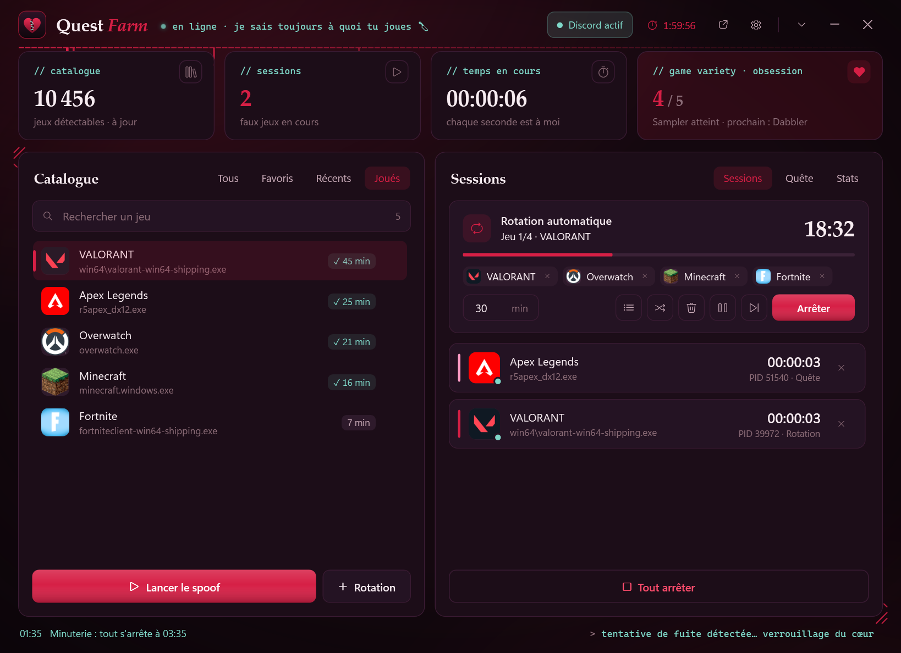

<p align="center">
  
</p>

<h1 align="center">Quest Spoofer</h1>

<p align="center">
  Simulateur de présence Discord pour Windows<br>
  <a href="README.md">English</a> · <b>Français</b>
</p>

<p align="center">
  
</p>

Quest Spoofer lance de **faux processus** qui portent le nom d'exécutables de jeux reconnus par Discord.
Discord croit alors que tu joues : pratique pour les quêtes « joue à X pendant N minutes ».

- **Aucun token, aucun mot de passe** : l'outil ne lit ni ne modifie rien dans Discord.
- **100 % local** : la seule connexion sert à télécharger la liste publique des jeux détectables (`discord.com/api/v10/applications/detectable`) et leurs icônes.
- **Aucun binaire tiers** : le faux exe est compilé sur ta machine à partir de [`app/Stub.cs`](app/Stub.cs).

> ⚠️ **Avertissement** — Projet non affilié à Discord. Simuler une activité de jeu peut enfreindre les
> conditions d'utilisation de Discord (perte des récompenses, suspension du compte). Tu l'utilises à tes risques.
> Les badges comme « Game Variety » sont calculés par Discord : rien ne garantit qu'ils progressent.

## Fonctionnalités

| | |
|---|---|
| 🎮 **Catalogue** | Plus de 10 000 jeux détectables, recherche (sans accents), favoris, récents, jeux déjà joués avec leur temps |
| 🔁 **Rotation** | File de jeux lancés un par un (N minutes chacun), pause / reprise (`Ctrl+Alt+S`), jeu suivant, listes enregistrées, export / import |
| 🚩 **Mode quête** | Un jeu + la durée demandée : compte à rebours, son et notification, arrêt automatique |
| ⏱️ **Minuterie** | Tout arrêter après 30 min à 8 h ou en fin de rotation, puis rien / veille / arrêt du PC |
| 📊 **Stats** | Temps simulé sur 14 jours, jeux les plus joués, compteur « Game Variety » |
| 🪟 **Faux jeux** | Petite carte avec l'icône du jeu et un chrono ; couleur, taille et coin de l'écran réglables |
| ⚡ **Réglages en direct** | Langue, couleurs et apparence des faux jeux s'appliquent tout de suite, même aux faux jeux déjà ouverts |
| 🧩 **Confort** | Mini-widget toujours visible, zone de notification, lancement avec Windows (option), raccourci bureau, diagnostic, français / anglais, 6 couleurs d'accent |
| 🪶 **Léger** | ~2 à 6 % d'un cœur et 60 à 130 Mo ; les faux jeux s'arrêtent avec l'outil, même en cas de plantage |

<p align="center">
  
  
</p>
<p align="center">
  
  
</p>

## Installation

1. **Prérequis** : Windows 10 ou 11, Windows PowerShell 5.1 et .NET Framework 4.x (présents par défaut), Discord pour PC.
2. Télécharge le projet (**Code → Download ZIP**) et extrais-le dans un dossier.
3. Double-clique sur **`Lancer.bat`**. Au premier lancement, l'outil compile le faux exe et télécharge le catalogue.
4. Dans **Réglages → Raccourci sur le bureau**, crée un raccourci avec la vraie icône pour les fois suivantes.

## Utilisation

- **Un jeu** : cherche-le, sélectionne-le, puis **Lancer le spoof** (ou `Entrée`).
- **Plusieurs jeux à la suite** : ajoute-les avec **Rotation** (`Ctrl+Entrée`) puis **Démarrer** dans l'onglet *Sessions*.
- **Une quête** : onglet *Quête*, choisis le jeu et la durée, puis **Lancer la quête**.
- Vérifie dans **Discord → Paramètres → Jeux enregistrés** que le jeu apparaît bien « en cours ».
- Discord doit rester ouvert : rotation et quête se mettent en pause s'il est fermé.

| Raccourci | Action |
|---|---|
| `Ctrl+Alt+S` | Pause / reprise de la rotation, même outil caché |
| `Ctrl+F` | Chercher un jeu |
| `Entrée` / `Ctrl+Entrée` | Lancer / ajouter à la rotation |
| `Ctrl+D` | Favori |
| `Suppr` | Arrêter la dernière session |
| `Échap` | Effacer la recherche, fermer les réglages |

## Structure du projet

```
Lancer.bat            lance l'outil sans console
QuestSpoofer.ps1      logique (PowerShell + WPF)
app/MainWindow.xaml   fenêtre principale
app/Widget.xaml       mini-widget
app/Types.cs          types C# (catalogue, sessions, job Windows, raccourci global, icône)
app/Stub.cs           source du faux exe
app/i18n.ps1          traductions anglaises
data/                 (créé à l'exécution) réglages, historique, cache du catalogue
games/                (créé à l'exécution) faux exe
```
