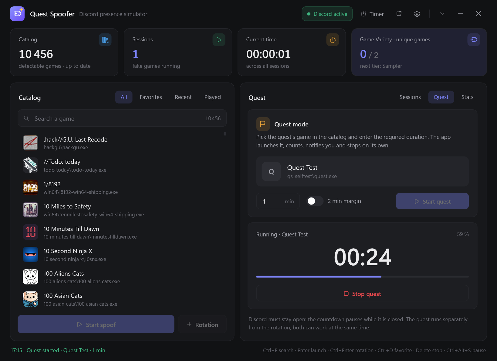
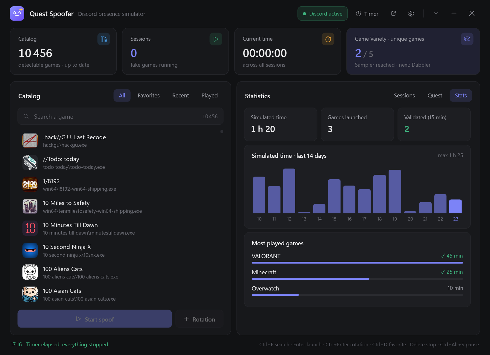
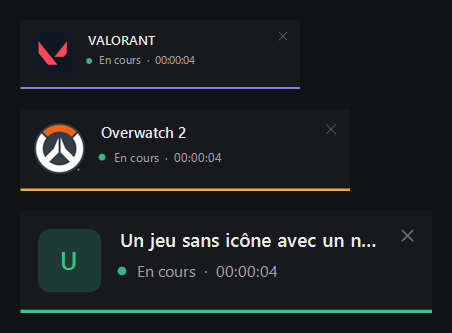
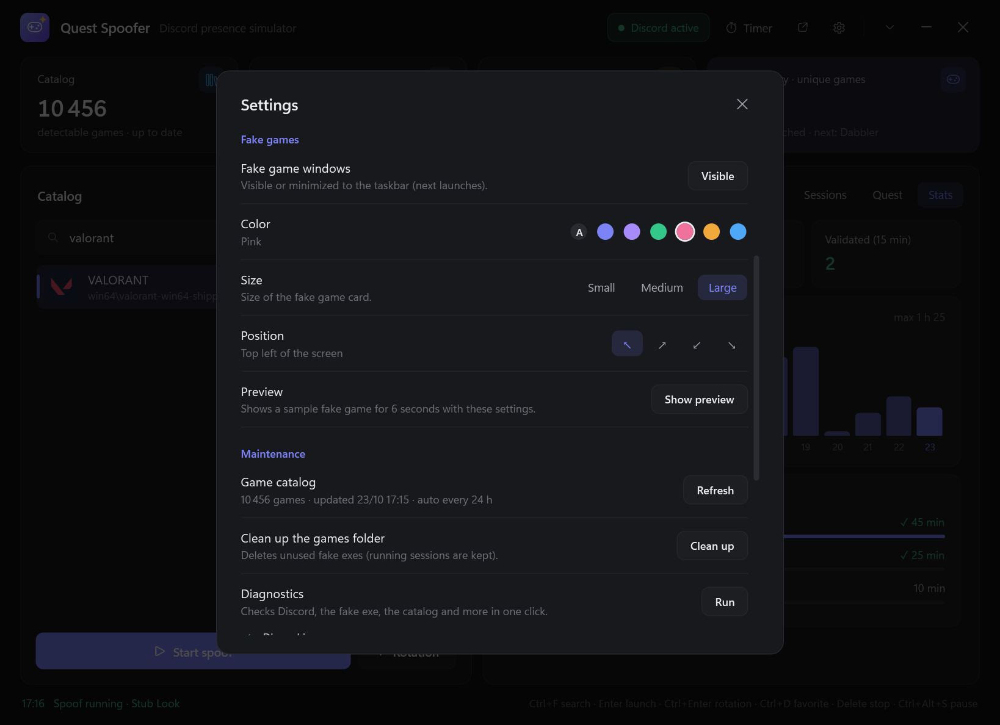

<p align="center">
  
</p>

<h1 align="center">Quest Spoofer</h1>

<p align="center">
  Discord presence simulator for Windows<br>
  <b>English</b> · <a href="README.fr.md">Français</a>
</p>

<p align="center">
  
</p>

Quest Spoofer starts **fake processes** named after game executables that Discord can detect.
Discord then thinks you are playing: handy for "play X for N minutes" quests.

- **No token, no password**: the app never reads or changes anything inside Discord.
- **100% local**: the only network access downloads Discord's public list of detectable games (`discord.com/api/v10/applications/detectable`) and their icons.
- **No third-party binary**: the fake exe is compiled on your machine from [`app/Stub.cs`](app/Stub.cs).

> ⚠️ **Disclaimer** — Not affiliated with Discord. Simulating game activity may break Discord's Terms of
> Service (lost rewards, account suspension). Use at your own risk. Badges such as "Game Variety" are computed
> by Discord: there is no guarantee they will progress.

## Features

| | |
|---|---|
| 🎮 **Catalog** | 10,000+ detectable games, accent-insensitive search, favorites, recent, played games with their time |
| 🔁 **Rotation** | Queue of games run one at a time (N minutes each), pause / resume (`Ctrl+Alt+S`), skip, saved lists, export / import |
| 🚩 **Quest mode** | One game + the required duration: countdown, sound and notification, automatic stop |
| ⏱️ **Timer** | Stop everything after 30 min to 8 h or when the rotation ends, then nothing / sleep / shut down |
| 📊 **Stats** | Simulated time over 14 days, most played games, "Game Variety" counter |
| 🪟 **Fake games** | Small card with the game icon and a timer; color, size and screen corner are configurable |
| ⚡ **Live settings** | Language, colors and fake game appearance apply instantly, even to fake games already running |
| 📱 **Phone app** | Control the PC app from your phone on the same Wi-Fi: sessions, rotation, game search, quests, timer, stats |
| 🧩 **Comfort** | Always-on-top mini widget, notification area, launch with Windows (optional), desktop shortcut, diagnostics, English / French, 6 accent colors |
| 🪶 **Lightweight** | ~2–6% of one core and 60–130 MB; fake games stop with the app, even if it crashes |

<p align="center">
  
  
</p>
<p align="center">
  
  
</p>

## Installation

1. **Requirements**: Windows 10 or 11, Windows PowerShell 5.1 and .NET Framework 4.x (installed by default), Discord desktop app.
2. Download the project (**Code → Download ZIP**) and extract it.
3. Double-click **`Lancer.bat`**. On first run the app compiles the fake exe and downloads the catalog.
4. Switch to English in **Settings → Language**, and create a desktop shortcut with the real icon in **Settings → Desktop shortcut**.

## Usage

- **One game**: search it, select it, then **Start spoof** (or `Enter`).
- **Several games in a row**: add them with **Rotation** (`Ctrl+Enter`), then **Start** in the *Sessions* tab.
- **A quest**: *Quest* tab, pick the game and the duration, then **Start quest**.
- Check in **Discord → Settings → Registered Games** that the game shows as running.
- Discord must stay open: rotation and quest pause while it is closed.

| Shortcut | Action |
|---|---|
| `Ctrl+Alt+S` | Pause / resume the rotation, even when hidden |
| `Ctrl+F` | Search a game |
| `Enter` / `Ctrl+Enter` | Launch / add to rotation |
| `Ctrl+D` | Favorite |
| `Delete` | Stop the latest session |
| `Esc` | Clear search, close settings |

## Phone app

A small web app, served by the PC app on your local network, lets you control everything from your phone
(Android or iPhone, no store needed).

1. On the PC: **Settings → Phone → Control from your phone**. The app shows an address and a 6-digit code.
2. On the phone, connected to the **same Wi-Fi**: open the address, then enter the code.
3. Optional: **Add to Home screen** in the browser menu installs it with its icon, full screen.

- Nothing goes through the Internet: the phone talks to the PC directly on your network (port `47820`).
- Without the code, nobody else on the network can control the app. **New code** disconnects every phone.
- The PC must stay on with Quest Spoofer and Discord open. If Windows asks for network access for PowerShell, allow private networks.

## Project structure

```
Lancer.bat            starts the app without a console
QuestSpoofer.ps1      logic (PowerShell + WPF)
app/MainWindow.xaml   main window
app/Widget.xaml       mini widget
app/Types.cs          C# types (catalog, sessions, Windows job, global hotkey, icon)
app/Stub.cs           fake exe source
app/Remote.cs         local server for the phone app
app/mobile/           phone app (HTML, CSS, JavaScript, icons)
app/i18n.ps1          English translations
data/                 (created at runtime) settings, history, catalog cache
games/                (created at runtime) fake exes
```
